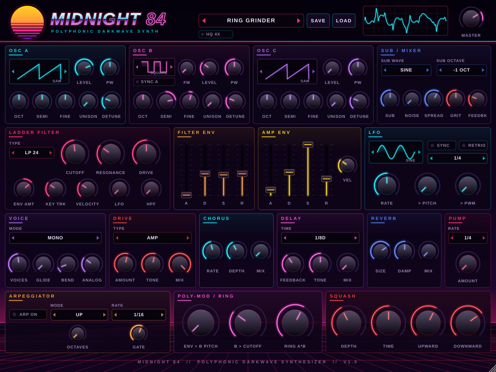

# Midnight 84

A polyphonic darkwave / synthwave synthesizer plugin (VST3, plus AU on macOS and a standalone app),
built for heavy, dark basses in the vein of Perturbator and Carpenter Brut. Its sound and layout draw on
the Behringer Poly D (ladder filter, mono/legato bass), Serum (unison stacks, wave displays) and
Harmor / Sawer (drive, pumping, big detuned saws).



**Listen:** [full demo](demo/midnight84_demo_full.mp3) · [bass lines only](demo/midnight84_demo_bass_only.mp3)
(rendered offline from the plugin itself with `tests/DemoSong.cpp`; the drums in the full mix are simple synthesized placeholders)

## Features

- **3 oscillators**: sine / triangle / saw / square, with octave, semitone, fine tune, pulse width,
  level, and up to **7-voice unison** with detune and stereo spread. All are band-limited (PolyBLEP).
- **Sub oscillator** (sine or square, -1 or -2 octaves) and a **noise** source.
- **4-pole transistor ladder filter** (zero-delay-feedback, Moog / Poly D style) with LP24, LP12, BP and HP24
  modes. It has resonance up to self-oscillation, input drive, envelope amount (bipolar), key tracking,
  velocity and LFO modulation.
- **Filter and amp envelopes** with analog-style exponential curves, shown as hardware-style faders.
- **LFO**: six shapes (including S&H). It can run free or sync to tempo (4 bars down to 1/32, including triplets),
  with optional retrigger. It modulates cutoff, pitch (vibrato) and pulse width.
- **Voice modes**: Poly (up to 16 voices), Mono, Legato. Glide, pitch-bend range, and **Analog drift**,
  which adds per-voice pitch and cutoff wander for that vintage instability.
- **FX chain**:
  - **Drive** (2x oversampled): Tube, Hard clip, Wavefolder and Bitcrush, with tone and mix
  - **Chorus**: Juno-ish width
  - **Delay**: tempo-synced ping-pong with a darkening filter in the feedback path
  - **Reverb**
  - **Pump**: tempo-synced sidechain-style ducking, for that pumping darksynth groove
- **Mod wheel** adds vibrato and filter wobble. The **sustain pedal** is supported.
- **15 factory presets**, also exposed as host programs, so they show up in FL Studio's preset menu.
  You can **save and load** your own sounds as `.m84` files (stored by default in `Documents/Midnight 84/Presets`).
- **Resizable UI** that keeps its aspect ratio (drag the bottom-right corner).

### Factory presets

| Preset | Character |
| --- | --- |
| Perturbed Bass | Detuned saws + sub through a plucky ladder filter, tube drive, mono glide |
| Brut Force | 5-voice unison saw + square sub, hard-clipped, pumping on the quarter note |
| Dark Reese | Detuned saw reese with a slow filter LFO and wavefolder grit, legato |
| Turbo Slayer | PWM square + saw, heavy filter drive and hard clip, hard pump |
| Ladder Mono Bass | Classic 3-oscillator Poly D–style mono bass with resonant ladder |
| Sub Doom | Square + sine sub, low and heavy |
| Pulse Wobble | Tempo-synced 1/8 filter wobble with folded drive |
| Night Drive Pluck | Poly pluck with chorus, dotted-8th delay and reverb |
| Hellfire Arp | Snappy arp pluck with delay and pump |
| Neon Lead | 7-voice supersaw lead with vibrato and delay |
| VHS Pad | Slow, warbly, chorused pad |
| Synth Brass 84 | 80s brass swell |
| Blade Stab | Big detuned stab into a long reverb |
| Outrun Chords | Chorused poly chords pumping in time |
| Init | Clean starting point |

## Getting the plugin

### Option 1: download a build (no compiling)

Every push to GitHub builds the plugin automatically with GitHub Actions:

1. Open the repository's **Actions** tab, then the latest **Build Midnight 84** run.
2. Under **Artifacts**, download **Midnight84-Windows-VST3** (or the macOS / Linux one).
3. Unzip it. You'll get a folder called `Midnight 84.vst3`.

Pushing a tag such as `v1.0.0` also publishes the zips on the repository's Releases page.

### Option 2: build it yourself

Requirements: CMake 3.22+, plus Visual Studio 2022 (Windows), Xcode (macOS) or GCC/Clang (Linux).
The build downloads JUCE automatically.

```bash
cmake -B build -DCMAKE_BUILD_TYPE=Release
cmake --build build --config Release
```

The output goes to `build/Midnight84_artefacts/Release/` (`VST3/`, `Standalone/`, and `AU/` on macOS).

## Installing in FL Studio (Windows)

1. Copy the whole `Midnight 84.vst3` folder to `C:\Program Files\Common Files\VST3\`.
2. In FL Studio, open **Options → Manage plugins**, then click **Find installed plugins**
   (enable "Verify plugins" if you like).
3. Find **Midnight 84** in the list and tick the star to add it to your favourites.
4. Add it to a project from the **Channel rack** (**+** button) or the **Plugin database → Generators**.

Factory presets are in FL Studio's plugin wrapper preset menu (the arrows at the top of the plugin window),
and in Midnight 84's own preset bar.

**macOS:** copy `Midnight 84.vst3` to `~/Library/Audio/Plug-Ins/VST3/` (and `Midnight 84.component` to
`~/Library/Audio/Plug-Ins/Components/` for Logic / GarageBand). The builds aren't notarised, so you may need to
run `xattr -dr com.apple.quarantine "~/Library/Audio/Plug-Ins/VST3/Midnight 84.vst3"` once.

## Tips for dark synthwave bass

- Start from **Perturbed Bass** or **Ladder Mono Bass**, and play low (A0–A2).
- Low **Cutoff** (100–400 Hz) plus a positive **Env Amt** and a short filter **Decay** gives the plucky
  "wow" of a darksynth bass. Raise **Resonance** for more squelch.
- **Filter Drive** saturates inside the ladder (warm). The **Drive** FX section distorts after the filter (aggressive).
  Hard or Fold at 40–70% gets you into Carpenter Brut territory.
- **Pump** set to 1/4 at 50–70% fakes the kick sidechain that is all over the genre.
- In **Mono** or **Legato** mode, use a little **Glide** (20–60 ms) for slides between overlapping notes.

## Controls

- Drag knobs up/down (or left/right). Use the mouse wheel for fine moves. **Double-click** resets to default.
- Hover a knob to see its exact value.
- Click the arrows on a selector to step through options, or click its middle for a menu.

## Project layout

```
Source/
  Parameters.*      parameter definitions
  DSP.h             oscillators, ladder filter, envelopes
  SynthEngine.*     voices, voice allocation, MIDI, LFO
  Effects.*         drive, delay, pump and the FX chain
  Presets.*         factory presets
  PluginProcessor.* plugin entry, state, presets
  LookAndFeel.*     synthwave styling
  Components.*      knobs, selectors, scope, preset bar
  PluginEditor.*    UI layout and background art
tests/RenderTest.cpp  offline render of every preset (cmake -DM84_BUILD_TESTS=ON)
tests/DemoSong.cpp    renders the demo track in demo/
```
